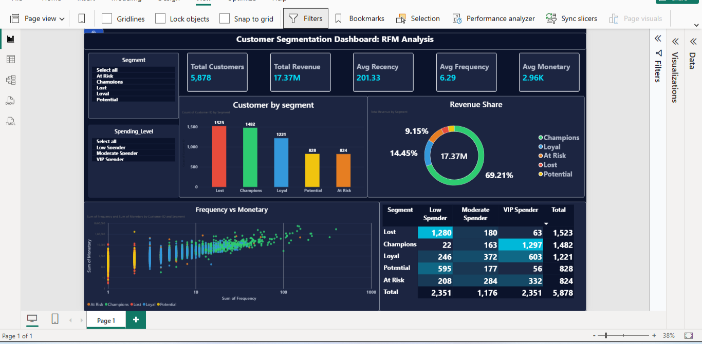

# Customer Segmentation using RFM Analysis (Python + Power BI)

Segmenting 5,878 customers of a UK online retailer by **Recency, Frequency and Monetary value**, then presenting the result in an interactive single-page Power BI dashboard.



## Business Problem
Sending the same offer to every customer wastes marketing budget. This project identifies which customers drive revenue, which are slipping away, and which are already lost, so each group can get a suitable action.

## Dataset
- [Online Retail II (UCI)](https://archive.ics.uci.edu/dataset/502/online+retail+ii): UK online retailer transactions (download it and place `online_retail_II.csv` next to the notebook).
- After cleaning: **5,878 customers**, **£17.37M** total revenue.

## Tools
Python (pandas, NumPy, matplotlib), Jupyter Notebook, Power BI, DAX

## Method
1. **Cleaning**: removed rows without Customer ID, cancelled invoices (starting with `C`), non-positive quantity/price and duplicates.
2. **RFM metrics** (snapshot date = last invoice date + 1 day):
   - Recency = days since last purchase
   - Frequency = number of unique invoices
   - Monetary = total spend (£)
3. **Scoring**: each metric split into quintiles (1 to 5).
4. **Segments** (from R and F scores):

| Segment | Rule |
|---|---|
| Champions | R ≥ 4 and F ≥ 4 |
| Loyal | R ≥ 3 and F ≥ 3 |
| At Risk | R ≤ 2 and F ≥ 3 |
| Lost | R ≤ 2 and F ≤ 2 |
| Potential | everything else |

5. **Spending level** from M score: VIP (4-5), Moderate (3), Low (1-2).

## Key Findings

| Segment | Customers | Share of customers | Share of revenue |
|---|---|---|---|
| Champions | 1,482 | 25% | **69.2%** |
| Loyal | 1,221 | 21% | 14.4% |
| At Risk | 824 | 14% | 9.1% |
| Lost | 1,523 | 26% | 3.8% |
| Potential | 828 | 14% | 3.4% |

- **Champions** are 25% of customers but generate about **69% of revenue**. They spend about £8.1K each on average (overall average £2.96K) and last purchased about 20 days ago.
- **1,297 of 1,482 Champions are VIP Spenders**: the group to protect with loyalty rewards and early access.
- **At Risk** customers (14%) bring 9% of revenue: send reminders and limited-time comeback offers.
- **Lost** customers are the largest group (26%) but contribute only 3.8% of revenue, and most (1,280) are Low Spenders: use low-cost reactivation and measure response before spending more.

## Dashboard
Single-page interactive Power BI dashboard:
- KPI cards: Total Customers, Total Revenue, Avg Recency, Avg Frequency, Avg Monetary
- Customers by Segment (bar), Revenue Share (donut)
- Segment × Spending Level matrix (heatmap)
- Frequency vs Monetary scatter (log scale)
- Segment and Spending Level slicers that cross-filter every visual

## Repository Structure
```
├── RFM-Project.ipynb          # analysis
├── RFM_Analysis_Final.csv     # RFM output used in Power BI
├── RFM.pbix                   # Power BI dashboard
├── RFM_Dashboard.png          # dashboard screenshot
└── README.md
```

## Limitations
- Segment rules use only Recency and Frequency; the Monetary score is used for spending level, not segmentation.
- Segments describe past behaviour and do not predict future purchases.
- Frequency/Monetary are heavily skewed, so the scatter uses a log scale.

## How to Run
1. Download the dataset and run `RFM-Project.ipynb` to generate `RFM_Analysis_Final.csv`.
2. Open `RFM.pbix` in Power BI Desktop (refresh the CSV path if needed).
